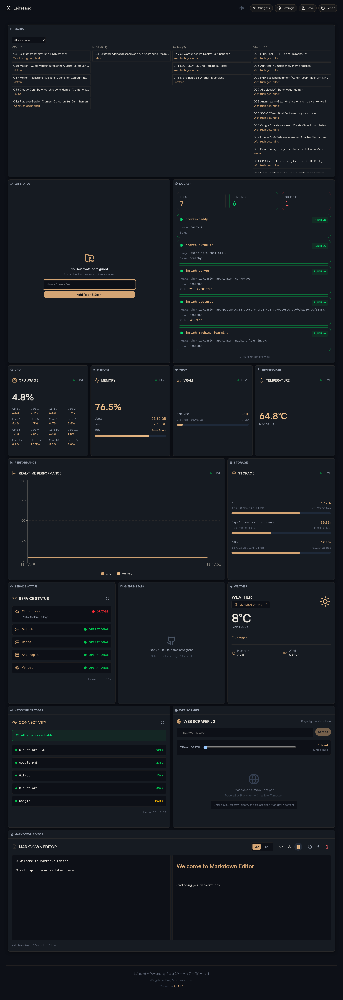
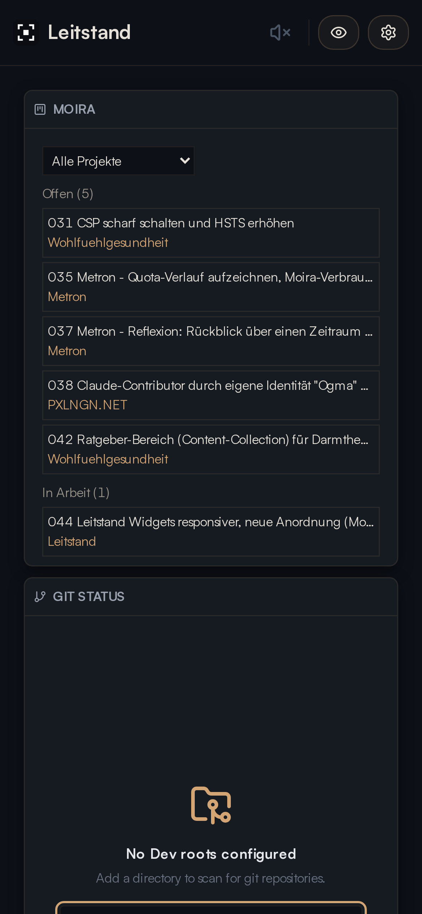

# 🚀 Leitstand

**Dev-Dashboard** für den Arbeitsrechner: Systemlast, Git-Repos, Docker und Dienst-Status auf einen Blick.

<p align="center">
  
  
  
  
</p>

> **Developer dashboard for your workstation: live system metrics, Git repos, Docker containers and service status in one view**

<p align="center">
  
  
</p>

## ✨ Features

### Widgets (real backend data)

| Widget                                                                                                                             | Data Source                                          |
| ---------------------------------------------------------------------------------------------------------------------------------- | ---------------------------------------------------- |
| **System Metrics** — CPU · Memory · Performance graph · VRAM · Storage · Temperature (six independent widgets, shared data stream) | `systeminformation` + nvidia-smi/amdgpu sysfs        |
| **Weather**                                                                                                                        | wttr.in API (proxied through the backend)            |
| **Docker Monitoring**                                                                                                              | Docker socket                                        |
| **Moira Board**                                                                                                                    | task files in `~/.local/share/moira/tasks` (`MOIRA_DIR`) |
| **Git Widget**                                                                                                                     | status, pull, push, fetch, commit, bulk operations   |
| **Web Scraper**                                                                                                                    | Playwright/Chromium (see NixOS note below)           |
| **GitHub Stats**                                                                                                                   | GitHub API (set your username in Settings)           |
| **Service Status**                                                                                                                 | Statuspage.io API (Cloudflare, GitHub, OpenAI, etc.) |
| **Connectivity Monitor**                                                                                                           | HTTP latency checks to internet endpoints            |
| **Network Outage Map**                                                                                                             | visualizes connectivity status                       |

Moira Board: columns can be hidden, ideas are captured raw (badge "Idee" until `/moira-new NNN` formulates and plans them), plan steps written as `- [ ]` checklist show a progress bar, and the hook `~/.claude/hooks/moira-activity.sh` (registered in `~/.claude/settings.json`) shows what Claude is doing right now on the card. Every card and the detail view has a copy button that puts the matching command on the clipboard (`/moira NNN`, `/moira-review NNN` in review, `/moira-new NNN` for ideas).

### Local-only widgets (no backend)

| Widget              | Storage                                                                                                                                   |
| ------------------- | ----------------------------------------------------------------------------------------------------------------------------------------- |
| **Markdown Editor** | `localStorage`                                                                                                                            |
| **Sound Manager**   | `<audio>` loop — drop a file at `public/audio/ambiance-legal.ogg` (not shipped in the repo); the widget shows a disabled state without it |

### Design

- **Shared design system**: colors, type scale, spacing and `ds-` components come from a shared Designsystem used by all my internal apps (a private sibling checkout at `../Designsystem`)
- **Drag & resize grid** on desktop, saved per browser
- **Single-column phone view** below 768px, in desktop reading order
- **Widget visibility panel** with a live health status per widget

## 🛠️ Tech Stack

### Frontend

- **React 19.2** - Latest React with Concurrent Features
- **Vite 7.3** - Lightning-fast build tool
- **TypeScript 5.9** - Type safety (shared wire types in `shared/types.ts`)
- **Tailwind CSS 4.1** - Utility-first styling (configured in `src/index.css`)
- **Recharts 3.6** - Data visualization
- **Lucide React** - Icon library
- **react-grid-layout** - Draggable/resizable widget grid

### Backend

- **Express 5.2** - Node.js API server
- **systeminformation** - Cross-platform system metrics
- **WebSockets (ws)** - Real-time metrics broadcast (one shared 2s loop for all clients)
- **Docker API** - Container status monitoring
- **Playwright** - Headless Chromium for web scraping
- **Helmet + CORS + express-rate-limit + Host-header allowlist** - Security layers

## 🚀 Quick Start

### Prerequisites

- **Node.js 22+**
- **pnpm**
- Optional: **Docker** (per-widget)

### Installation

```bash
git clone https://github.com/darkjive/Leitstand.git
cd Leitstand
pnpm install

# Start frontend (http://localhost:5180) + backend (http://localhost:3010)
pnpm dev:all

# Or start separately:
pnpm dev        # Frontend only (Vite) - http://localhost:5180
pnpm dev:server # Backend only (Express) - http://localhost:3010
```

> Build scripts: pnpm blocks postinstall scripts by default; this repo allowlists
> `electron` and `esbuild` in `pnpm-workspace.yaml`. If the Electron binary is
> still missing after install, run `pnpm approve-builds`.

### Configuration

The dashboard works out of the box with defaults. For overrides, copy `.env.example` to `.env`:

```bash
cp .env.example .env
```

| Variable                    | Default     | Purpose                                                                                                                                             |
| --------------------------- | ----------- | --------------------------------------------------------------------------------------------------------------------------------------------------- |
| `BIND_HOST`                 | `127.0.0.1` | Network interface to bind the backend to (loopback default)                                                                                         |
| `PORT`                      | `3010`      | Backend port (also picked up by the Vite proxy + Electron)                                                                                          |
| `DASHBOARD_TOKEN`           | _(empty)_   | Shared token for destructive endpoints. Empty = open (loopback default). **Required** when `BIND_HOST=0.0.0.0`.                                     |
| `LEITSTAND_ALLOWED_HOSTS`   | _(empty)_   | Extra host names the Vite dev server accepts (comma-separated), e.g. a reverse proxy's public name.                                                 |
| `LEITSTAND_ALLOWED_ORIGINS` | _(empty)_   | Exact page origins (`https://host:port`) allowed to open the metrics WebSocket besides loopback. Only for an authenticating reverse proxy in front. |

> Frontend dev is `5180`, Vite preview is `4173`.

### ⚠️ Security defaults

The backend **binds to loopback (`127.0.0.1`) by default** — only your local browser can reach it. This is intentional: there is **no authentication** on any endpoint, and several can act on your behalf (`/api/git/push|commit`, `/api/scrape`).

Additional guards:

- **Host-header allowlist** against DNS-rebinding attacks (active on loopback binds).
- **SSRF guard** on the scraper: literal + DNS-resolved private-range checks, re-checked after redirects.
- **Path validation**: git endpoints resolve paths and block sensitive system prefixes (`/etc`, `/proc`, `/root`, …).

- **Optional token gate**: set `DASHBOARD_TOKEN` to require an `X-Dashboard-Token` header on
  **the entire `/api` surface — reads included**, plus a `?token=` query param on the metrics
  WebSocket (browsers cannot set headers on a WS handshake). Reads are gated because endpoints
  like `/api/git/scan` and `/api/docker` expose filesystem layout and running containers — gating only the destructive half would leave an exposed instance wide
  open. `/health` stays open for uptime probes. Configure the matching token under
  **Settings → General → Dashboard Token** in the browser. When unset, the API stays open
  (fine for the loopback default). The token is compared in constant time.

If you really need LAN access, opt in explicitly **and set a token**:

```bash
DASHBOARD_TOKEN=$(openssl rand -hex 16) BIND_HOST=0.0.0.0 pnpm dev:server   # exposes backend — token now required
```

The server logs a loud warning on startup if it binds to a non-loopback interface without a token.

### Optional system tools

Widgets degrade gracefully if a tool is missing, and report the reason in their JSON response.

| Tool                | Required by  | Install hint                   |
| ------------------- | ------------ | ------------------------------ |
| Docker daemon       | DockerWidget | user in `docker` group         |
| Playwright Chromium | WebScraper   | `pnpm exec playwright install` |

### Customization

Open **Settings** (gear icon in the header) to configure the GitHub username,
weather location, dashboard token, sound and git roots.
Everything is persisted in `localStorage`.

#### Colors and styles

Colors, font sizes, spacing and radii are tokens from the shared Designsystem
(`src/index.css` imports `../Designsystem/*.css`). Change them there, not in this app;
app-specific Tailwind settings and keyframes live in the `@theme {}` block of `src/index.css`.

## 📁 Project Structure

```
Leitstand/
├── shared/
│   └── types.ts                  # Wire types shared by server + frontend
├── server/
│   ├── index.ts                  # Express API (all routes inline)
│   └── services/                 # One file per concern
│       ├── systemMetrics.ts
│       ├── weather.ts
│       ├── docker.ts
│       ├── gitStatus.ts
│       ├── scraper.ts
│       └── netGuard.ts           # SSRF guard (literal + DNS checks)
├── src/
│   ├── components/               # One file per widget (+ Toaster)
│   │   └── metrics/              # Six metric widgets (CPU, Memory, Graph, VRAM, Storage, Temp)
│   ├── lib/
│   │   ├── settings.ts           # useSetting/useSettingJSON hooks (localStorage + sync)
│   │   ├── metricsStore.ts       # Singleton metrics store (one WS + HTTP-polling fallback)
│   │   ├── api.ts                # apiFetch wrapper (attaches optional dashboard token)
│   │   └── toast.ts              # toast() notifications
│   ├── App.tsx                   # Main dashboard grid layout
│   ├── index.css                 # Tailwind + Designsystem imports
│   └── main.tsx                  # React entry point
├── electron/
│   └── main.cjs                  # Electron shell (spawns server + vite)
├── .env.example
├── eslint.config.js              # ESLint flat config (browser + node blocks)
├── tsconfig.server.json          # Backend typecheck (run by pnpm build)
├── package.json
└── README.md
```

## 🔌 API Endpoints

### Backend (`http://localhost:3010`)

| Endpoint                        | Description                                       |
| ------------------------------- | ------------------------------------------------- |
| `GET /api/metrics`              | System metrics (CPU, RAM, Disk, VRAM) — cached 2s |
| `GET /api/weather?location=...` | Weather from wttr.in                              |
| `GET /api/docker`               | Docker container status — cached 5s               |
| `GET /api/service-status`       | Aggregated Statuspage.io data                     |
| `GET /api/connectivity`         | HTTP latency probes                               |
| `GET/POST /api/git/*`           | status, pull, push, fetch, commit, bulk           |
| `POST /api/scrape`              | Playwright scraper (SSRF-guarded)                 |
| `GET /health`                   | Health check                                      |
| `WebSocket /ws`                 | Real-time metrics stream (2s broadcast)           |

All endpoints are rate-limited (1000 req/min general, stricter for the scraper).
When `DASHBOARD_TOKEN` is set, everything under `/api` plus the WebSocket requires the token —
only `GET /health` stays open.

## 🧩 Optional Integrations

Widgets degrade gracefully if the underlying tool is missing.

| Widget       | Requires                                                          |
| ------------ | ----------------------------------------------------------------- |
| WebScraper   | `pnpm exec playwright install` (NixOS: see below)                 |
| DockerWidget | Docker daemon socket access                                       |
| Git          | shells out; paths validated server-side (blocked system prefixes) |

### NixOS Note (Playwright)

NixOS doesn't ship standard glibc paths Playwright expects. Use [`playwright-nix`](https://github.com/nginx-nixos/playwright-nix) or run Chromium via a FHS env. See [NixOS wiki: Playwright](https://nixos.wiki/wiki/Playwright).

## 🎯 Use Cases

- **Developer control center** – Watch CPU, memory, VRAM and temperature while builds, dev servers and local models run.
- **Repo overview** – See dirty, ahead and behind repos across your project folders and pull, push or commit in bulk.
- **Local stack at a glance** – Check Docker containers, connectivity and upstream service status (GitHub, Vercel, Anthropic, …) without leaving the dashboard.

## 🔧 Development

```bash
pnpm build      # typechecks frontend (tsc -b) AND backend (tsconfig.server.json), then vite build
pnpm typecheck:server  # backend typecheck only
pnpm preview    # Preview production build (port 4173)
pnpm lint       # ESLint (browser globals for src/, node globals for server/)
pnpm format     # Prettier
pnpm desktop    # Electron dev (spawns server + vite)
pnpm desktop:prod  # vite build, then Electron loads backend-served bundle on :3010
```

No test framework or CI is set up — `pnpm build` + `pnpm lint` are the verification gates.

## 📄 License

MIT — see [LICENSE](LICENSE).

## 🙏 Acknowledgments

- **[Homepage by gethomepage](https://github.com/gethomepage/homepage)** - Dashboard structure inspiration
- **[wttr.in](https://wttr.in)** - Weather data API
- **[systeminformation](https://github.com/sebhildebrandt/systeminformation)** - System metrics library
